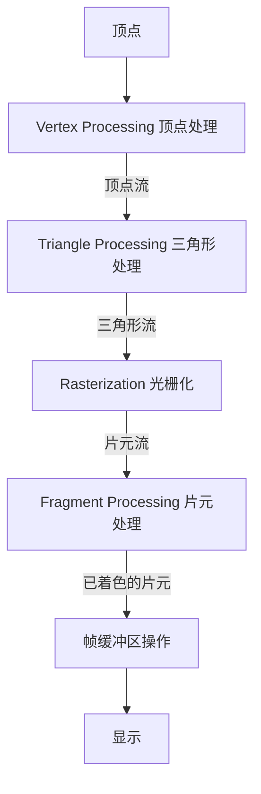

# Shading 2

## Bling-Phong 反射模型

### 高光
- 观察方向和反射方向接近 => 半程向量h和n接近 => 镜面反射法线是角平分线 => $\mathbf{h}=\frac{\mathbf{v}+\mathbf{l}}{\|\mathbf{v}+\mathbf{l}\|}$
- 镜面反射：$L_s=k_s(I/r^2)max(0,\mathbf{n}\cdot\mathbf{h})^p$
  > p指数用于控制高光在夹角稍大时能量迅速衰减，收束高光的范围

### 环境光照
- 环境光照：$L_a = k_aI_a$，$I_a$是环境光

### 总光能量
- 总能量（对应颜色）：环境光+漫反射+高光反射

## 着色频率
- Face面着色：对每个面着色，每个面的颜色相同
- Vertex顶点着色：对每个顶点着色，顶点内的三角形通过一次插值算出来着色
  >通过计算包含该顶点的所有三角形的法向量的加权平均：
  >$N_v=\frac{\sum_iN_i}{\|\sum_iN_i\|}$
- Pixel像素着色：逐像素着色
  >通过重心坐标插值计算每个像素对应的法线

## Graphics Pipeline 实时渲染管线

## Texture Mapping 纹理映射
- 每一个三角形顶点对应一个纹理点 $(u,v)$
- 纹理坐标系$u-v: [0,1]\times[0,1]$

